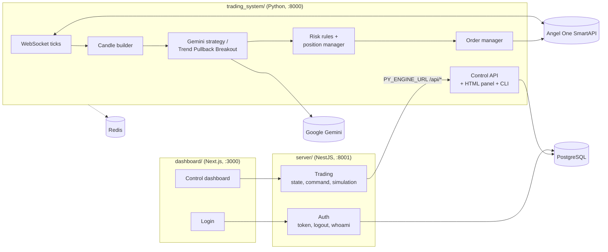

# Trade Automation

An autonomous intraday trading engine for NSE and NFO through **Angel One SmartAPI**. Google **Gemini** reads the candles and decides when to trade. Fixed risk rules in code size every position and stop trading for the day once the loss limit is hit. A NestJS control server and a Next.js dashboard let you watch it and step in.

It starts in **simulation mode** (`IS_SIMULATION=true`) and is set up for a small ₹10,000 account.

> Personal project for learning. Not investment advice. Trading can lose money.

## How it fits together



| Part | Where | What it does |
|---|---|---|
| Dashboard | `dashboard/` | Login page and a control dashboard with live state, trades and charts. |
| Control server | `server/` | NestJS API. Signs users in (JWT cookie, users in Postgres via Prisma) and forwards state requests and commands to the Python engine. |
| Market data | `trading_system/data/` | Subscribes to Angel One's WebSocket and builds candles from ticks. |
| Strategies and AI | `trading_system/strategy/`, `ai/`, `ml/` | `gemini_strategy.py` (Gemini 1.5 Flash makes the call), `tpb_strategy.py` (Trend Pullback Breakout: 9:15 to 9:30 range, pullback to VWAP, confirmation candle), a Gemini trade check, and an XGBoost direction predictor. |
| Risk | `trading_system/risk/` | Sizes each trade from the risk amount and stop distance; enforces daily loss, consecutive losses and max open positions. |
| Orders | `trading_system/execution/` | SmartAPI login with TOTP and order placement. |
| Engine API and panel | `trading_system/api/`, `static/`, `cli/` | FastAPI control routes, a built-in HTML panel and a `rich` terminal menu. |
| Storage | `trading_system/storage/` | SQLAlchemy trade records. |
| Backtest | `trading_system/backtesting/orb_backtest.py` | vectorbt sketch of a 9:15 to 9:45 opening-range breakout. |

## Default risk settings

Set in `trading_system/config/config.py`:

| Setting | Value |
|---|---|
| Capital | ₹10,000 |
| Risk per trade | ₹100 |
| Max daily loss | ₹300 |
| Max consecutive losses | 3 |
| Max open positions | 2 |
| No new trades after | 14:30 |
| Auto square-off | 15:10 |

## Engine control API

Served by `trading_system/api/dashboard_routes.py`:

| Method | Path | Does |
|---|---|---|
| GET | `/api/health` | Health check |
| GET | `/api/state` | P&L, position, risk state and the AI's reasoning |
| POST | `/api/command` | Start, stop or other engine commands |
| GET | `/api/trades` | Trade history |
| POST | `/api/trade/manual` | Place a manual trade |
| POST | `/api/trade/exit` | Exit the open position |
| POST | `/api/simulation/toggle` | Switch simulation on or off |
| POST | `/api/kill` | Kill switch |
| POST | `/api/recovery/tpb` | Rebuild the TPB setup from history after a restart |

## Running it

**1. Configure.** Copy the env template and fill in your Angel One and Gemini keys:

```bash
cp trading_system/.env.example trading_system/.env
```

You need `SMARTAPI_API_KEY`, `SMARTAPI_CLIENT_ID`, `SMARTAPI_PASSWORD`, `SMARTAPI_TOTP_TOKEN` and `GEMINI_API_KEY`. Leave `IS_SIMULATION=true` until you trust it.

**2. Engine, Postgres and Redis** with Docker:

```bash
docker-compose up --build
```

Or run the engine directly:

```bash
pip install -r trading_system/requirements.txt
python -m trading_system.main
```

**3. Control server:**

```bash
cd server
npm install
npx prisma migrate dev
npm run start:dev          # http://localhost:8001
```

Set `DATABASE_URL`, and `PY_ENGINE_URL` if the engine isn't on `http://localhost:8000`.

**4. Dashboard:**

```bash
cd dashboard
npm install
npm run dev                # http://localhost:3000
```

Set `NEXT_PUBLIC_API_URL` if the control server isn't on `http://localhost:8001`.

**Terminal menu** (talks to the engine on port 8000):

```bash
python -m trading_system.cli.menu
```

## Known issues

- The Docker image starts `trading_system.main:app`, which only serves `/`. The `/api/*` routes the control server calls are defined on a separate FastAPI app in `trading_system/api/dashboard_routes.py`, so the two need to be joined (or the right app started) for the dashboard to work.
- The engine's control routes don't check who is calling, and CORS there allows every origin with credentials.
- `docker-compose.yml` falls back to a default Postgres password if `POSTGRES_PASSWORD` isn't set.
- `tmp_ws_test.py` is a scratch script for testing the SmartAPI WebSocket.

## Tech stack

Python · FastAPI · Angel One SmartAPI · Google Gemini · XGBoost · pandas-ta · vectorbt · SQLAlchemy · PostgreSQL · Redis · NestJS · Prisma · Next.js 16 · React 19 · Chart.js · Docker
